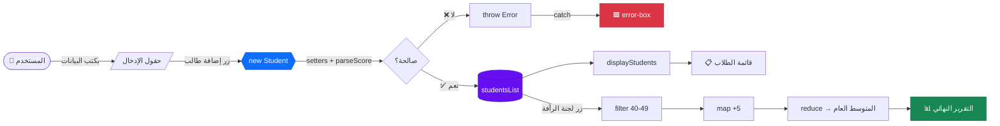
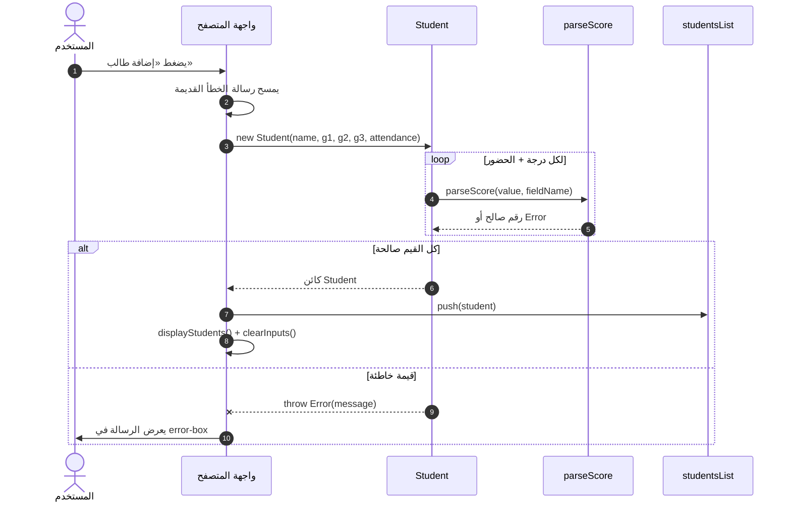
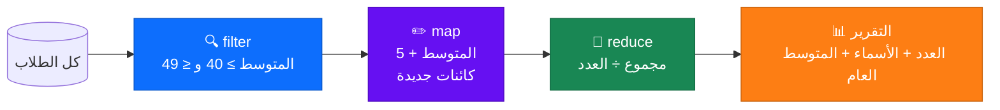

<!-- ═══════════════════════════ HERO ═══════════════════════════ -->
<div align="center">


<a href="https://github.com/">
  
</a>

<br/>


<br/>


<br/><br/>

**أضف الطلاب ← تحقّق صارم من كل مدخل ← فعّل لجنة الرأفة ← احصل على تقرير فوري.**

<br/>

[**✨ المميزات**](#-المميزات) &nbsp;•&nbsp;
[**🧠 المعمارية**](#-المعمارية-وتدفق-البيانات) &nbsp;•&nbsp;
[**🛡️ التحقق**](#️-منظومة-التحقق) &nbsp;•&nbsp;
[**🎓 لجنة الرأفة**](#-لجنة-الرأفة-بالتفصيل) &nbsp;•&nbsp;
[**🚀 التشغيل**](#-التشغيل-في-10-ثوانٍ) &nbsp;•&nbsp;
[**🗂️ الهيكل**](#️-هيكل-المشروع)

</div>


<div dir="rtl">

## 📖 نظرة سريعة

**نظام إدارة النتائج** تطبيق ويب خفيف مكتوب بـ **Vanilla JavaScript** بدون أي مكتبات أو أدوات بناء. تدخل بيانات الطالب (الاسم، درجات ثلاث مواد، نسبة الحضور)، فيتحقق النظام من كل قيمة قبل قبولها، ثم تقدر تفعّل **لجنة الرأفة** لتحصل على تقرير فوري عن الطلاب المتعثرين ومتوسطهم العام بعد إضافة درجات الرأفة.

المشروع مبني ليكون **مرجعًا نظيفًا** لتطبيق مفاهيم JavaScript الحديثة في مكان واحد: الكلاسات، والتغليف، ومعالجة الأخطاء، والدوال العليا على المصفوفات.

</div>

<br/>

<div align="center">

| 🧱 &nbsp;**OOP حقيقي** | 🛡️ &nbsp;**تحقق من أول سطر** | 🧮 &nbsp;**Functional Pipeline** | ⚡ &nbsp;**صفر إعداد** |
|:---:|:---:|:---:|:---:|
| حقول خاصة `#` مع `get` / `set` | لا يُنشأ الكائن أصلًا لو القيمة خاطئة | `filter` ← `map` ← `reduce` | افتح `index.html` وخلاص |

</div>

<br/>

<div dir="rtl">

## ✨ المميزات

<table dir="rtl">
<tr>
<td width="50%" valign="top">

### 🧑‍🎓 إدارة الطلاب
- إضافة طالب بخمسة حقول: الاسم + ثلاث درجات + الحضور
- قائمة مرقّمة تتحدث فورًا بعد كل إضافة
- تفريغ الحقول تلقائيًا بعد نجاح الإضافة
- أسماء الطلاب تُعرض بأمان عبر `escapeHtml` (مفيش حقن HTML)

</td>
<td width="50%" valign="top">

### 🛡️ تحقق صارم
- منع الاسم الفارغ
- منع الحقول الفارغة (وإصلاح فخ `Number("") === 0`)
- قبول الأعداد الصحيحة فقط
- نطاق مسموح من `0` إلى `100`
- رسائل خطأ عربية واضحة تظهر على الشاشة

</td>
</tr>
<tr>
<td width="50%" valign="top">

### 🎓 لجنة الرأفة
- تصفية الطلاب بمتوسط من `40` إلى `49` (شامل الحدين)
- إضافة `5` درجات للمتوسط بدون المساس بالبيانات الأصلية
- حساب المتوسط العام بعد الرأفة
- حالة خاصة تمنع القسمة على صفر

</td>
<td width="50%" valign="top">

### 🎨 واجهة عصرية
- Bootstrap 5.3.3 بنسخة **RTL** كاملة
- شريط عنوان بتدرج لوني
- تخطيط متجاوب: عمودان على الشاشات الكبيرة، وعمود واحد على الموبايل
- نصوص إرشادية تختفي تلقائيًا بـ `:empty::before`

</td>
</tr>
</table>

</div>

<br/>

<div dir="rtl">

## 🧠 المعمارية وتدفق البيانات

</div>



<div dir="rtl">

### تسلسل التفاعل عند الضغط على «إضافة طالب»

</div>




<div dir="rtl">

## 🛡️ منظومة التحقق

كل قيمة تمر على **ثلاث بوابات متتالية** داخل الدالة `parseScore`. لو فشلت في أي بوابة يتوقف كل شيء ويُرمى خطأ برسالة محددة.

| البوابة | الفحص | مثال مرفوض | الرسالة |
|:---:|---|:---:|---|
| **1** | الحقل ليس فارغًا | `""` | يرجى إدخال … الحقل فارغ أو قيمته غير صالحة |
| **2** | عدد صحيح بدون كسور أو رموز | `45.5` &nbsp; `abc` | … يجب أن تكون عددًا صحيحًا |
| **3** | داخل النطاق `0 – 100` | `101` &nbsp; `-5` | … يجب أن تكون بين 0 و 100 |

> [!IMPORTANT]
> **ليه نفحص الفراغ أولًا؟** لأن `Number("")` ترجع `0`، فكانت الدرجة الفارغة هتعدّي كأنها صفر صحيح. الترتيب هنا مقصود.

<details>
<summary><b>🔬 شوف الكود الفعلي للتحقق (اضغط للتوسيع)</b></summary>

<br/>

```javascript
function parseScore(value, fieldName) {
  const text = toTrimmedText(value);

  // 1) فراغ؟
  if (text === "") {
    throw new Error(`يرجى إدخال ${fieldName}؛ الحقل فارغ أو قيمته غير صالحة.`);
  }

  // 2) عدد صحيح؟
  if (!/^-?\d+$/.test(text)) {
    throw new Error(`${fieldName} يجب أن تكون عددًا صحيحًا.`);
  }

  // 3) داخل النطاق؟
  const number = Number(text);
  if (number < MIN_SCORE || number > MAX_SCORE) {
    throw new Error(`${fieldName} يجب أن تكون بين ${MIN_SCORE} و ${MAX_SCORE}.`);
  }

  return number;
}
```

</details>

<details>
<summary><b>🔒 كيف يعمل التغليف (Encapsulation) في كلاس Student؟</b></summary>

<br/>

الحقول الخمسة **خاصة فعليًا** بعلامة `#`، فلا يمكن الوصول لها أو تعديلها من خارج الكلاس. وحتى الـ constructor نفسه يمرّر القيم على الـ setters، فالتحقق يحدث مرة واحدة في مكان واحد.

```javascript
class Student {
  #name; #grade1; #grade2; #grade3; #attendance;

  constructor(name, grade1, grade2, grade3, attendance) {
    this.name = name;            // ← يمر على setter ويتحقق
    this.grade1 = grade1;
    this.grade2 = grade2;
    this.grade3 = grade3;
    this.attendance = attendance;
  }

  get grades() {                 // ← نسخة جديدة في كل مرة
    return [this.#grade1, this.#grade2, this.#grade3];
  }

  calculateAverage() {
    const total = this.grades.reduce((sum, g) => sum + g, 0);
    return Math.round((total / this.grades.length) * 100) / 100;
  }
}
```

**النتيجة:** مفيش كائن `Student` بيانات غير صالحة يقدر يتولد في الذاكرة أصلًا.

</details>

</div>


<div dir="rtl">

## 🎓 لجنة الرأفة بالتفصيل

عند الضغط على **«تفعيل لجنة الرأفة»** يمر الطلاب على خط إنتاج من ثلاث مراحل:

</div>



<div dir="rtl">

### ⚙️ الثوابت القابلة للتعديل

كل قواعد اللجنة في أول `js/main.js`، فتغيير السياسة لا يحتاج لمس المنطق:

```javascript
const MIN_SCORE = 0;          // أقل درجة مسموحة
const MAX_SCORE = 100;        // أعلى درجة مسموحة
const GRACE_RANGE_MIN = 40;   // بداية نطاق الرأفة (شامل)
const GRACE_RANGE_MAX = 49;   // نهاية نطاق الرأفة (شامل)
const GRACE_MARKS = 5;        // درجات الرأفة المضافة
```

### 🧪 مثال عملي

أضفنا ستة طلاب:

| الطالب | الدرجات | المتوسط | هل يدخل اللجنة؟ | بعد الرأفة |
|---|:---:|:---:|:---:|:---:|
| أحمد | 45 · 42 · 48 | **45.00** | ✅ نعم | **50.00** |
| منى | 40 · 44 · 46 | **43.33** | ✅ نعم | **48.33** |
| خالد | 48 · 47 · 46 | **47.00** | ✅ نعم | **52.00** |
| سارة | 90 · 85 · 95 | 90.00 | ❌ فوق النطاق | — |
| عمر | 30 · 35 · 41 | 35.33 | ❌ تحت النطاق | — |
| ليلى | 50 · 50 · 49 | 49.67 | ❌ أعلى من 49 | — |

**التقرير الناتج:**

```text
عدد الطلاب المتعثرين: 3
أسماء الطلاب المتعثرين:
  1. أحمد
  2. منى
  3. خالد
المتوسط العام بعد الرأفة: 50.11
```

> [!NOTE]
> **نقاط يجب الانتباه لها:**
> - نسبة الحضور **لا تدخل** في حساب لجنة الرأفة إطلاقًا، فهي تُحفظ مع الطالب فقط.
> - الفلترة تتم على المتوسط **بعد تقريبه لخانتين**، فطالبة متوسطها `49.67` (مثل ليلى) خارج النطاق لأنها أكبر من `49`.
> - بيانات الطلاب الأصلية **لا تتغير**؛ `map` ينتج كائنات جديدة للتقرير فقط.
> - لو مفيش طلاب مؤهلون يظهر «لا يوجد طلاب متعثرون» بدل خطأ القسمة على صفر.

</div>


<div dir="rtl">

## 🚀 التشغيل في 10 ثوانٍ

مفيش `npm install` ولا سيرفر ولا إعداد. المشروع ملفات ثابتة.

</div>

```bash
# 1) انسخ المشروع
git clone <رابط-المستودع>
cd results-management-system

# 2) افتحه في المتصفح
open index.html          # macOS
start index.html         # Windows
xdg-open index.html      # Linux
```

<div dir="rtl">

<details>
<summary><b>💡 تفضّل تشغيله على سيرفر محلي؟</b></summary>

<br/>

```bash
# Python
python -m http.server 8080

# أو Node
npx serve .
```

ثم افتح `http://localhost:8080`.

</details>

<details>
<summary><b>🌐 النشر المجاني على GitHub Pages</b></summary>

<br/>

1. ادخل **Settings ← Pages**
2. اختر **Deploy from a branch**
3. اختر الفرع `main` والمجلد `/ (root)`
4. بعد دقيقة يكون المشروع شغالًا على رابط عام

</details>

> [!TIP]
> الاتصال بالإنترنت مطلوب مرة واحدة فقط لتحميل Bootstrap من الـ CDN. كل شيء غيره محلي.

</div>


<div dir="rtl">

## 🗂️ هيكل المشروع

</div>

```text
results-management-system/
│
├── 📄 index.html          ← الواجهة (RTL) + ربط Bootstrap والملفات
│
├── 🎨 css/
│   └── style.css          ← تنسيقات خفيفة فوق Bootstrap (≈ 900 بايت)
│
└── ⚡ js/
    └── main.js            ← كلاس Student + التحقق + الأحداث + لجنة الرأفة
```

<div dir="rtl">

### أين أجد كل شيء في `main.js`؟

| القسم | المحتوى |
|---|---|
| **الثوابت** | حدود الدرجات وقواعد لجنة الرأفة |
| **دوال التحقق** | `toTrimmedText` و `parseScore` |
| **كلاس `Student`** | الحقول الخاصة، `get` / `set`، `calculateAverage()` |
| **العناصر والمخزن** | `studentsList` + الإمساك بعناصر الصفحة |
| **دوال العرض** | `escapeHtml` و `displayStudents` و `clearInputs` |
| **زر إضافة طالب** | `try / catch` + إنشاء الكائن |
| **زر لجنة الرأفة** | `filter` ← `map` ← `reduce` + بناء التقرير |

</div>

<br/>

<div dir="rtl">

## 🧰 التقنيات والمفاهيم المطبقة

</div>

<div align="center">

| المفهوم | أين يظهر |
|:---|:---|
| 🏛️ **Classes** | `class Student` |
| 🔒 **Private Fields** | `#name` `#grade1` `#grade2` `#grade3` `#attendance` |
| 🎛️ **Getters / Setters** | التحقق عند كل تعيين قيمة |
| 🚨 **try / catch / throw** | زر الإضافة + رسائل الأخطاء |
| 🔍 **Array.filter** | اختيار الطلاب المتعثرين |
| 🔄 **Array.map** | حساب المتوسط الجديد دون تعديل الأصل |
| ➕ **Array.reduce** | جمع الدرجات والمتوسط العام |
| 🧬 **Template Literals** | بناء HTML الخاص بالقائمة والتقرير |
| 🧼 **XSS Prevention** | `escapeHtml` عبر `textContent` |
| 🪄 **CSS `:empty::before`** | نص إرشادي يختفي تلقائيًا |

</div>

<br/>

<div dir="rtl">

## 🔭 أفكار للتطوير

- [ ] حفظ الطلاب في `localStorage` ليبقوا بعد إعادة تحميل الصفحة
- [ ] حذف وتعديل الطالب من القائمة
- [ ] عرض متوسط وتقدير (ممتاز / جيد جدًا …) بجانب كل اسم
- [ ] تصدير التقرير إلى CSV أو PDF
- [ ] استخدام نسبة الحضور كشرط إضافي لأهلية الرأفة
- [ ] اختبارات وحدة لكلاس `Student` ودالة `parseScore`
- [ ] وضع داكن (Dark Mode)

</div>

<br/>

<div dir="rtl">

## 🤝 المساهمة

أي تحسين مرحّب به:

1. اعمل **Fork** للمستودع
2. أنشئ فرعًا جديدًا: `git checkout -b feature/my-idea`
3. ثبّت تعديلاتك: `git commit -m "Add my idea"`
4. ارفع الفرع: `git push origin feature/my-idea`
5. افتح **Pull Request**

</div>

<br/>

<!-- ═══════════════════════════ FOOTER ═══════════════════════════ -->
<div align="center">


</div>
